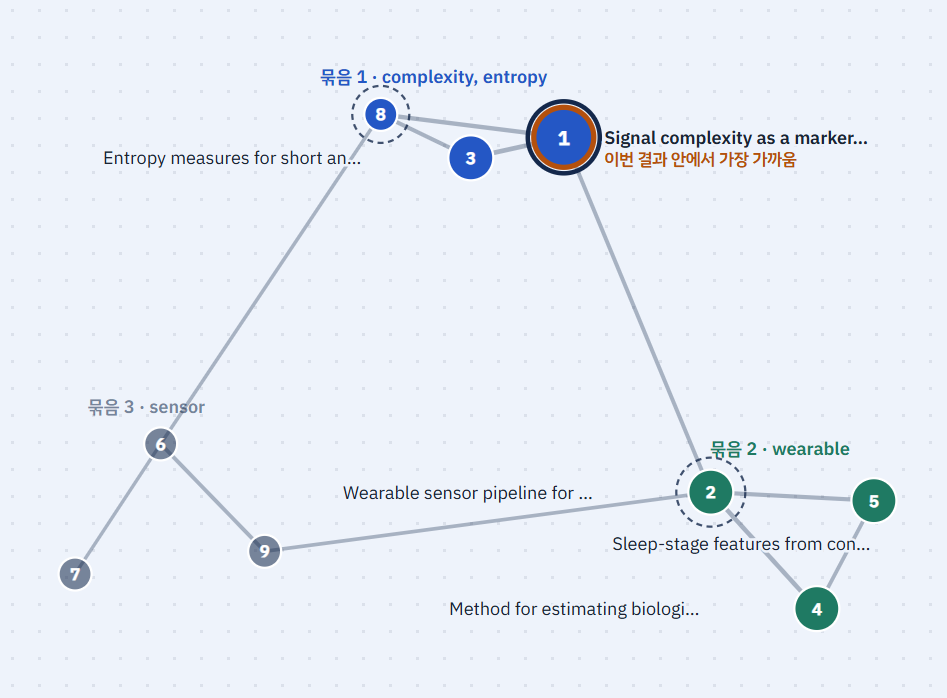

# Atlas

**기술 아이디어와 가까운 논문을 찾아 지도로 보여 주고, 왜 이어졌는지 근거를 함께 보여 주는 문헌 탐색 도구입니다.**
논문과 특허를 잇는 빈자리 찾기를 목표로 합니다.

> **요약**
> - 성능을 재는 기준을 먼저 정해 두고, 그 기준으로 검증했습니다.
> - 작은 시험에서 같은 문제에만 맞춰질 위험(과적합 위험)을 발견했습니다. 그래서 논문 150편으로 다시 검증했고, 결과에 따라 설계 방향을 바꿨습니다.
> - 그 결과, 찾아야 할 정답 문헌이 후보에 드는 비율이 **9%에서 28%** 로 올랐습니다.

**기술 스택**: FastAPI · Next.js · PostgreSQL + pgvector · Neon · Vercel · Koyeb · OpenAlex · OpenAI·Anthropic API

<!-- TODO(사용자): 문헌 지도 스크린샷을 넣는다. 가상 예시 데이터로 캡처하고, 실제 사용자 입력은 쓰지 않는다. -->
<p align="center">
  
  <br>
  <em>문헌 지도 화면 (가상 예시 데이터)</em>
</p>

## 사명

전공과 관계없이 누구나 문헌을 탐색하고, 그 결과를 정직하게 읽을 수 있게 합니다. 서로 다른 분야가 만나는 지점을 찾도록 돕습니다.

## 장기 목표

데이터 사이언스·데이터 마이닝 작업 흐름에서 **"문헌 탐색 단계"의 표준 도구**가 되는 것입니다. 새 기능은 "다른 도구와 이어지는가"를 기준으로 고릅니다.

- 이어질 곳 (아직 목표이고, 구현 순서는 운영 공개 뒤에 정합니다)
  - Python 라이브러리: 주피터에서 바로 씁니다 (`atlas-research`, PyPI 에 공개)
  - 참고문헌 관리 도구용 내보내기 (BibTeX, RIS)
  - CSV·JSON 내보내기 (pandas, 엑셀, Orange3 로 이어서 분석)
  - Orange3 애드온 (라이선스 확인 뒤)
  - 방법의 투명성: 벤치마크, 정답지, 한계를 공개합니다

## 무엇을 하나

| 기능 | 설명 | 상태 |
|---|---|---|
| 문헌 지도 | 질의와 가까운 논문을 의미 임베딩으로 찾아 그래프로 보여 줍니다. 비슷한 논문끼리 묶고, 묶음을 잇는 논문을 "다리 후보"로 표시합니다 | SaaS 사전 공개 단계. 다리 후보는 휴리스틱이고, 정답 세트로 구분력을 검증하지 않았습니다 |
| 연결 근거 | 두 논문이 왜 이어졌는지 근거가 있는 이유와 공유 단어만 보입니다 | 비전공자가 실제로 이해하는지는 사용자 조사로 확인하지 않았습니다 |
| 구성 요소 대조표 | 아이디어를 요소로 나누고, 요소마다 가까운 논문의 초록에서 근거 문장을 인용합니다. AI 가 낸 인용이 초록에 그대로 있는지 코드로 검사합니다 | **개발 플래그 안의 프로토타입**입니다. 운영에 열지 않았고, 판정 기준은 사람 재검토 전입니다 |

- 지금은 논문만 다룹니다. 특허 연결과 빈자리(아직 이어지지 않은 지점) 찾기는 목표이며 검증 전입니다.
- "못 찾음"은 "이 검색 범위 안에서 못 찾음"이라는 뜻이고, 법적 판단이 아닙니다. 화면과 응답에 검색 범위를 함께 적습니다.

## 어떻게 검증했나

| 단계 | 한 일 | 배운 것 |
|---|---|---|
| 1. 작은 시험 (질의 8개) | 같은 8개로 수집 방식을 다섯 번 조정 | 한두 개만 바뀌어도 결론이 뒤집힐 수 있다 → 과적합 위험 |
| 2. 정답지 v2 (논문 150편) | 기준을 먼저 고정하고, 조정용 50편과 확인용 100편으로 나눔 | 병목은 순위가 아니라 후보를 모으는 범위였다 |
| 3. 방향 전환 | 미리 쌓기를 보류하고, 그때그때 모으기 + 참고문헌 따라가기를 택함 | 확인용 100편에서 정답 문헌이 후보에 드는 비율 9.3% → 28.0% |

<details>
<summary><b>검증 세부 (규칙, 결과 표, 한계)</b></summary>

### 1. 벤치마크 v1 (질의 8개) — 과적합 위험
- 처음에는 사람이 고른 질의 8개와 정답 문헌으로 쟀습니다.
- 수집 방식을 고르면서 **같은 8개로 다섯 번 조정**했습니다. 마지막 결과는 "미리 쌓기 + 그때그때"를 합쳤을 때 후보 안 정답 6/8, Hit@10 4/8 이었습니다.
- 8개에서 정답 한두 개만 바뀌어도 결론이 뒤집힐 수 있었습니다. 그래서 같은 8개로 하던 조정을 멈추고 정답지를 새로 만들었습니다.

### 2. 정답지 v2 (질의 150편) — 규칙을 먼저 고정
- 질의: OpenAlex 기술 분야(subfield 54개) 2022~2024년 논문 150편의 제목과 초록. 무작위 표본에서 seed 를 고정해 뽑았습니다.
- 정답: 각 질의 논문의 참고문헌 중 초록이 있는 것, 3,895편
- **측정 전에 고정한 규칙**
  - 조정용 50편과 확인용 100편으로 나눕니다. 방식은 조정용으로만 고르고, 확인용은 마지막에 한 번만 잽니다.
  - 시간 순서: 후보는 질의 논문의 출판 연도 이하만 남깁니다. 선행 문헌은 아이디어보다 먼저 나온 것이기 때문입니다.
  - 질의 논문 자신과 그 다른 판은 모든 후보에서 뺍니다.
  - 요약은 평균보다 분포를 먼저 봅니다: 0% 인 질의 비율, 구간별 질의 수, 부트스트랩 95% 구간(1,000회, seed 고정).
  - "천장"(합친 후보 안에 정답이 든 비율)을 따로 적습니다. 순위를 아무리 잘 매겨도 넘을 수 없는 상한입니다.

### 3. 결과로 방향을 바꿈
- 첫 측정(150편)
  - 미리 쌓기(기술 분야별 인용 많은 순 4.5만 편)는 Hit@10 27%, 그때그때 모으기는 51% 였습니다.
  - 둘을 합쳐도 그때그때보다 나은 정도가 구간 안이었습니다.
  - 천장은 15.9% 였습니다. 병목이 순위가 아니라 **후보를 모으는 범위**라는 것이 드러났습니다.
- 범위 넓히기 실험(조정용 50편): 검색 연도 필터, 검색어·쪽 수 늘리기, 상위 5·10편의 참고문헌 따라가기를 비교했습니다. 미리 정한 규칙(Recall@50 구간이 기준선과 겹치지 않는 것 중 가장 싼 것)으로 "연도 필터 + 상위 5편 참고문헌 따라가기"를 골랐습니다.
- 확인용 측정 전에 "다른 판" 규칙을 보강했습니다. 같은 해이고 제목 단어 겹침이 0.8 이상이면 다른 판으로 봅니다.
- 확인용 100편 (한 번만 측정)

| 방식 | 천장 [95% 구간] | Recall@50 [95% 구간] | Hit@10 [95% 구간] | OpenAlex 무료 한도로 하루 처리 가능한 질의 |
|---|---|---|---|---|
| 기준선 (그때그때) | 9.3% [7.7, 11.1] | 7.5% [6.0, 9.1] | 53% [43, 63] | 500 |
| **연도 필터 + 참고문헌 따라가기** | **28.0% [23.9, 32.4]** | **12.4% [10.3, 14.7]** | 62% [52, 71] | 약 400 |

- 결정: 미리 쌓기는 보류합니다. 이득이 작고 구간이 겹치며 용량·관리 부담이 큽니다. 그때그때 모으기와 참고문헌 따라가기를 쓰고, 모은 문헌은 DB 에 저장해 다시 씁니다.

### 한계 (그대로 적습니다)
- **정답이 참고문헌**입니다. 비슷한 논문의 참고문헌을 따라가면 서지 결합 때문에 효과가 부풀 수 있습니다. 실제 선행 기술 찾기 효과는 특허 정답지(특허 앞면 인용, 심사관 인용)로 다시 확인해야 합니다.
- 상위 10 지표(Recall@10, Hit@10)는 개선 구간이 기준선과 겹칩니다. 다음 과제는 순위 개선입니다.
- 질의가 논문 초록 말투라 실제 사용자 입력(짧은 아이디어)과 다릅니다.
- 다른 판 규칙의 0.8 은 조정용 한 사례를 보고 정한 값입니다.
- 결과는 2022~2024년 기술 분야 150편 범위로만 해석합니다.

</details>

## 데이터 파이프라인

```
수집 (OpenAlex) → 정제 → 임베딩 → 저장 (pgvector) → 재사용
```

<details>
<summary><b>파이프라인 세부 (단계별 처리, 비용·처리량)</b></summary>

```
수집 (OpenAlex search·목록)
  → 정제 (초록 복원, 논문 아닌 기록·다른 판·미래 연도 제거, 중복 방지)
  → 임베딩 (text-embedding-3-small, 1536차원)
  → 저장 (PostgreSQL + pgvector, halfvec + HNSW)
  → 재사용 (같은 문헌은 다시 임베딩하지 않음)
```

- **수집**: Haiku 가 만든 검색어 2개로 OpenAlex 를 검색하고(질의 연도까지만), 임베딩 순위 상위 5편의 참고문헌을 더합니다.
- **정제**
  - OpenAlex 의 역색인(inverted index) 초록을 문장으로 복원합니다.
  - 임베딩 입력은 8,000자에서 자릅니다. 토큰 한도 초과 오류를 겪은 뒤 정한 값입니다.
- **저장**
  - `(source, source_id)` UNIQUE 와 "없을 때만 넣기"로 중복 저장을 막습니다.
  - 벡터는 float16(halfvec)으로 저장합니다. 개발 DB(160편)에서 표 크기는 10.1 MB → 1.6 MB 였고, 질의 8개의 상위 10편은 정확한 검색과 HNSW 가 같았습니다.
- **비용·처리량** (확인용 측정 기준 추정, 임베딩 재사용 없음)
  - 질의당 약 $0.004: OpenAlex $0.0025, 임베딩 $0.0015, Haiku $0.0001
  - OpenAlex 무료 한도로 하루 약 400 질의
  - 외부 호출 시간은 중앙값 5.1초

</details>

<details>
<summary><b>데이터 품질 문제를 규칙으로 정리한 사례 5건</b></summary>

| 문제 | 어떻게 알았나 | 규칙 |
|---|---|---|
| 초록 속 줄 구분 문자(U+2028 등) | `splitlines()` 가 JSONL 한 줄을 여러 줄로 끊음 | 파일은 `\n` 으로만 나눠 읽는다 |
| 가짜 초록 (출판사 안내문이 초록 자리에 있음) | 정답 손 확인 중 발견 | OpenAlex `has_abstract` 판정을 따르고, 모든 방식에 같은 필터를 쓴다 |
| 논문이 아닌 기록 (학술지·논문집 자체) | 정답 3,897편의 type 전수 조회 → `paratext` 15편 | 정답에서 뺀다 (뺀 전후 수치를 함께 기록, 변화 0.1%p 미만) |
| 미래 연도 인용 | 질의보다 늦은 정답 6편을 하나씩 조회 → arXiv 판이 학술지판 연도로 합쳐진 것 2편 등 | 후보는 질의 연도 이하. 검색 결과의 약 28% 가 미래 연도였다 |
| 다른 판 (arXiv·학회판) | 검색이 거의 모든 질의에서 질의 논문 자신을 찾아옴(151건). 제목이 조금 다른 같은 논문 사례 | 같은 제목, 또는 같은 해 + 제목 단어 겹침 0.8 이상이면 뺀다 |

</details>

## 개발 방식 (AI-native)

처음부터 AI 코딩 도구로 개발했습니다. 저는 계획 승인, 코드와 보고서 검토, 측정 설계, 결정을 맡았습니다.

<details>
<summary><b>안전장치, 기록, 사고 1건과 교훈</b></summary>

- **안전장치**
  - 운영 DB 차단: 측정·적재 스크립트는 운영 엔드포인트가 주소에 들어 있으면 거부합니다. 운영 엔드포인트 값이 없을 때도 실행하지 않습니다.
  - 비용 한도: 주제마다 누적 한도를 두고, 넘을 것 같으면 멈춥니다. 정답지 v2 주제는 한도 $2 중 약 $1.45 를 썼습니다.
  - 측정 전 규칙 고정: 정답지, 지표, 고르는 기준을 결과를 보기 전에 문서로 고정합니다.
  - 쓰기 SQL 의 브랜치 ID 가드: 쓰기 SQL 은 맨 앞에서 현재 DB 브랜치 ID 를 확인하고, 다르면 트랜잭션을 멈춥니다.
  - 비밀값은 출력·저장·커밋하지 않습니다.
- **기록**
  - 설계 결정 기록(ADR) 27건
  - 자동 테스트 298개
  - CI(GitHub Actions): 운영과 같은 의존성 버전으로 백엔드 테스트, 라이브러리 패키지를 Python 3.10·3.12 로 빌드·검사
- **사고 기록 1건 (2026-10-28)**
  - 개발 DB 에만 적용하려던 스키마 SQL 이 운영 DB 에도 실행되었습니다. 콘솔 편집기의 브랜치 선택이 실행 사이에 바뀌었기 때문입니다.
  - 사용자 영향은 없었습니다. 운영 문헌이 0편이었고, 결과도 의도한 상태와 같았습니다.
  - 교훈은 세 가지입니다.
    - 쓰기 직전에 대상을 확인합니다.
    - 쓰기 SQL 이 스스로 대상 브랜치를 확인하게 합니다 (위 가드).
    - 확인 결과를 기대값과 바로 비교합니다. 이번 사고도 행 수 불일치로 알아챘습니다.

</details>

## 지금 상태와 다음 단계 (운영 공개 전)

- **지금**
  - 오픈소스 라이브러리 `atlas-research`: PyPI 에 1.4.2 공개, 1.4.3 준비 중 (Apache-2.0)
  - SaaS 는 사전 공개 단계입니다. 운영 DB 스키마(halfvec, HNSW, 중복 방지)는 준비되었고, 운영 수집 코드는 아직 없습니다.
  - 수집 방식(그때그때 + 참고문헌 따라가기)은 측정 스크립트에서 검증했고, 운영 코드에는 아직 넣지 않았습니다.
- **다음**
  1. 순위 개선: 하이브리드(BM25 + 임베딩)를 조정용 50편으로 잽니다.
  2. 특허 정답지로 다시 확인합니다 (특허 앞면 논문 인용 → USPTO 심사관 인용).
  3. 운영 수집 코드와 DB 저장·재사용
  4. 인증·요청 수 제한, 초록 이용 조건 확인 뒤 운영 공개
